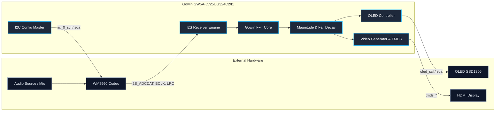

# Real-Time Audio Spectrum Visualizer (ACG525 FPGA)

A real-time audio spectrum analyzer and visualizer implemented on the **Gowin ACG525 / Tang Primer 25K** development board (**GW5A-LV25UG324C2/I1**). 

The system streams digital audio through the on-board **WM8960** codec via I2S, processes the frequency bins using an FPGA FFT pipeline, and outputs visualizer bars directly to an **HDMI** display (and optional **OLED SSD1306**).

---

## 🏗 System Architecture

---

## ⚡ Key Features

- **Audio Acquisition:** Hardware I2C controller initializes **WM8960** registers on boot; receives 16-bit signed PCM audio via I2S ($F_s = 48\text{ kHz}$).
- **Real-Time FFT Pipeline:** Pipelined streaming Fast Fourier Transform with magnitude calculation and smooth peak-decay fall-off animation.
- **Dual Display Support:** 
  - **HDMI (TMDS):** Full spectrum bar rendering with color gradients.
  - **OLED (SSD1306):** Optional portable display interface over I2C.
- **Hardware Platform:** Optimized specifically for **Gowin GW5A-LV25UG324C2/I1** (ACG525 / Tang Primer 25K).

---

## 📍 Pin Assignment (GW5A-LV25UG324C2/I1)

| Category | Signal | Pin | Direction | Description |
| :--- | :--- | :--- | :--- | :--- |
| **Clock & Reset** | `clk` | `T9` | Input | 50 MHz Onboard Crystal Oscillator |
| | `reset_n` | `C15` | Input | Key Reset (Active-Low, Pull-up) |
| **Audio Codec (WM8960)** | `iic_0_scl` | `L7` | Output | I2C Clock for WM8960 |
| | `iic_0_sda` | `H5` | Inout | I2C Data for WM8960 |
| | `I2S_MCLK` | `J6` | Output | I2S Master Clock |
| | `I2S_BCLK` | `K5` | Input | I2S Bit Clock |
| | `I2S_ADCLRC` | `J7` | Input | I2S ADC Left/Right Clock |
| | `I2S_ADCDAT` | `H3` | Input | I2S ADC Serial Data |
| | `I2S_DACLRC` | `K6` | Input | I2S DAC Left/Right Clock |
| | `I2S_DACDAT` | `E3` | Output | I2S DAC Serial Data |
| **OLED (SSD1306 - P9)** | `oled_scl` | `R3` | Output | OLED I2C Clock |
| | `oled_sda` | `T3` | Output | OLED I2C Data |
| **HDMI Display (TMDS)** | `tmds_clk_p` / `_n` | `M10` / `N9` | Output | TMDS Clock Differential Pair |
| | `tmds_data_p[0]` / `_n[0]` | `R7` / `T7` | Output | TMDS Data 0 (Blue) |
| | `tmds_data_p[1]` / `_n[1]` | `T6` / `V6` | Output | TMDS Data 1 (Green) |
| | `tmds_data_p[2]` / `_n[2]` | `R5` / `T5` | Output | TMDS Data 2 (Red) |
| **LEDs** | `led[4:1]` | `A9`, `B9`, `C14`, `D14` | Output | Status & Activity LEDs |

---

## 🚀 How to Run

1. **Open Project:** Open `project/*.gprj` in **Gowin EDA (YunYuan)**.
2. **Verify Device:** Confirm the target part is set to `GW5A-LV25UG324C2/I1` (`GW5A-25`).
3. **Build:** Run **Synthesize** $\rightarrow$ **Place & Route** to generate the `.fs` bitstream file.
4. **Program:**
   - Plug the ACG525 board into your PC via USB-C.
   - Open **Gowin Programmer**, select the generated `.fs` file.
   - Program under **SRAM Mode** (quick verification) or **embFlash Mode** (persistent boot).

---

## 📜 License & Author

- **Author:** [Phan Công Bình](https://github.com/congbinh245) - FPT University Da Nang
- **License:** [MIT](LICENSE)